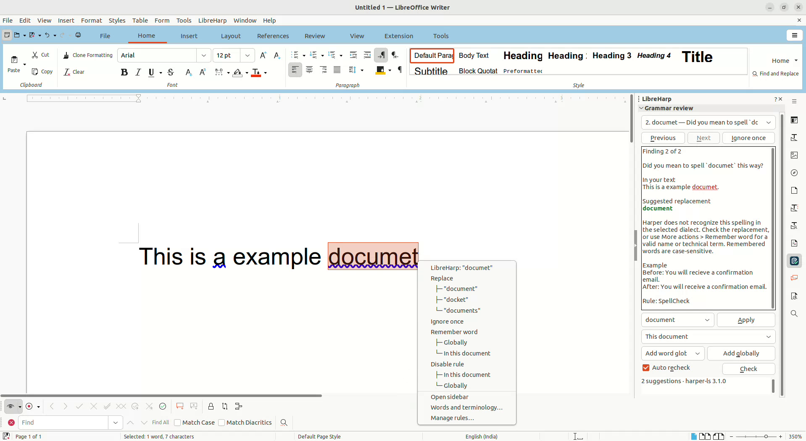

#  LibreHarp

Offline English spelling and grammar checking for LibreOffice Writer, powered by Harper. Review suggestions in the sidebar or act directly from the right-click menu. Set rules and vocabulary for each document, project, or personal profile.

## Install

LibreHarp runs on Linux x86-64 and requires LibreOffice with Python 3.11 or later.

1. [Download LibreHarp v0.9](https://github.com/kaustubhmote/libreharp/releases/download/v0.9/LibreHarp_v0.9.oxt).
2. Add the OXT in LibreOffice's **Extension Manager** and restart LibreOffice.
3. Choose **LibreHarp → Open sidebar**.

For underlines and right-click suggestions, choose **LibreHarp → Use LibreHarp for English checking**. This changes the profile's English checkers. **Restore previous English checkers** switches them back.

[Changelog](CHANGELOG.md) · [Build and test](docs/TESTING.md) · [0BSD license](LICENSE) · [Third-party notices](THIRD_PARTY.md)

Maintained by Kaustubh R. Mote, with AI development assistance from Codex.
